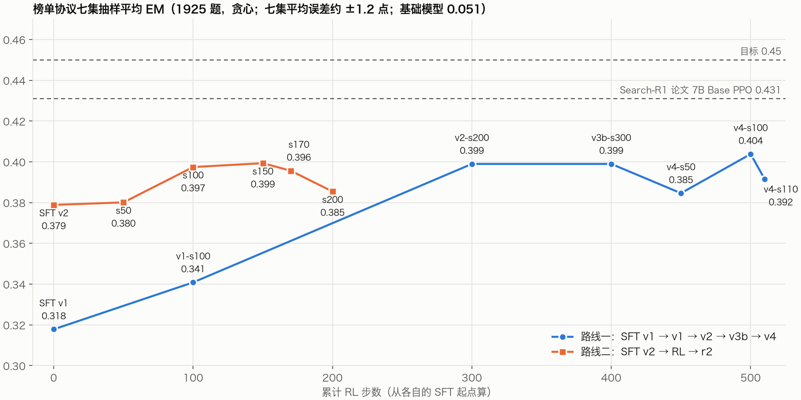

# RWKV-RL-Search-R1

在 Search-R1（NQ / HotpotQA）环境上给 RWKV-7 2.9B 做 SFT + GRPO。按 [SearchAgent Leaderboard](https://huggingface.co/spaces/TencentBAC/SearchAgent_Leaderboard) 协议评测（七集抽样，e5 top-3，贪心），两条路线目前都在 0.40 左右；Search-R1 论文 7B Base PPO 是 0.431。



## 文档

| 文档 | 内容 |
|---|---|
| [全线总览](docs/rl-lineage.md) | **先看这篇**：两条路线、全部检查点的分集分数、训练曲线、上限与错题归因、下一步 |
| [RL 状态 2026-10-29](docs/rl-status-2026-10-29.md) | 路线二 r2 评测、pass@8 上限、错题归因、夜间调参探针（结论：下一步上 Dr. GRPO） |
| [SFT v2 规划](docs/sft-v2-plan.md) | 为什么从基础模型重做 SFT、数据管线、教师蒸馏 |
| [RL 状态 2026-10-27 下午](docs/rl-status-2026-10-27-pm.md) | 对齐榜单协议、v4 结案、链路评测 |
| [RL 状态 2026-10-27](docs/rl-status-2026-10-27.md) | v3b 结案、检索配置矩阵、e5 检索基建 |
| [RL 状态 2026-10-26](docs/rl-status-2026-10-26.md) | v1、v2、v3b：筛题、两段式学习 |

留存快照（训练指标、脚本副本、命令、校验和）：

- [全线 RL 训练指标](provenance/rl-lineage-20261029/README.md)：重画图用 `.venv/bin/python scripts/plot_rl.py`
- [SFT v2 数据与训练](provenance/sft-v2-20261027/README.md)

## 环境

```bash
uv sync                    # 主依赖：torch、rwkv、datasets 等
uv sync --all-groups       # 另外装上检索服务（faiss + e5）
```

- macOS：PyPI 默认版本的 torch（MPS），检索用 `faiss-cpu`
- Linux：CUDA 13.0 版 torch（`download.pytorch.org/whl/cu130`），检索用 `faiss-gpu-cu12`

## 环境变量

服务地址、服务器主机和教师接口的密钥都不入库，统一放在 `.env`：

```bash
cp .env.example .env      # 填上真实地址和密钥
set -a; source .env; set +a
```

脚本的默认地址都读这些变量（`RWKV_API`、`RETRIEVER_URL`、`TUNE_SERVER` 等）。文档和归档的 `report.json` 里出现的 `$RWKV_API`、`$TRAIN_HOST` 之类，都是指 `.env` 里对应的值。

## 本地 BM25 检索

```bash
uv run python retriever/build_corpus_store.py   # 一次性：wiki-18 语料 → 分块压缩存储（约 7 分钟，内存 <100MB）
uv run python retriever/bm25_server.py          # 127.0.0.1:8000/retrieve，接口同 Search-R1
```

需要 Java 21（默认找 Homebrew 的 `openjdk@21`，也可以自己设 `JAVA_HOME`）。服务常驻内存约 700MB。

## 推理 API

2.9B 基模部署在 `$RWKV_API`，后端是 [rwkv_lightning_cuda](https://github.com/Alic-Li/rwkv_lightning_cuda)，用 `/v1/batch/completions` 做续写。

## 目录

- `data/`：Search-R1 数据（`PeterJinGo/nq_hotpotqa_train`）
- `models/`：RWKV 权重
- `outputs/`：评测和训练输出
- `docs/`：实验报告（索引见上面的「文档」）
- `provenance/`：各阶段的留存快照
- `scripts/`：蒸馏、评测、GRPO 客户端、筛题、画图脚本
- `retriever/`：BM25 / e5 / e5 重排检索服务
