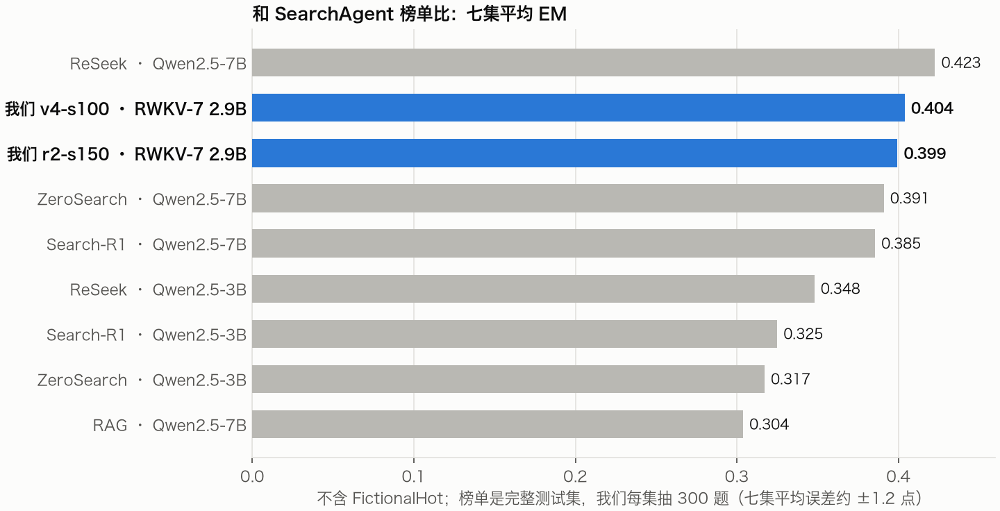
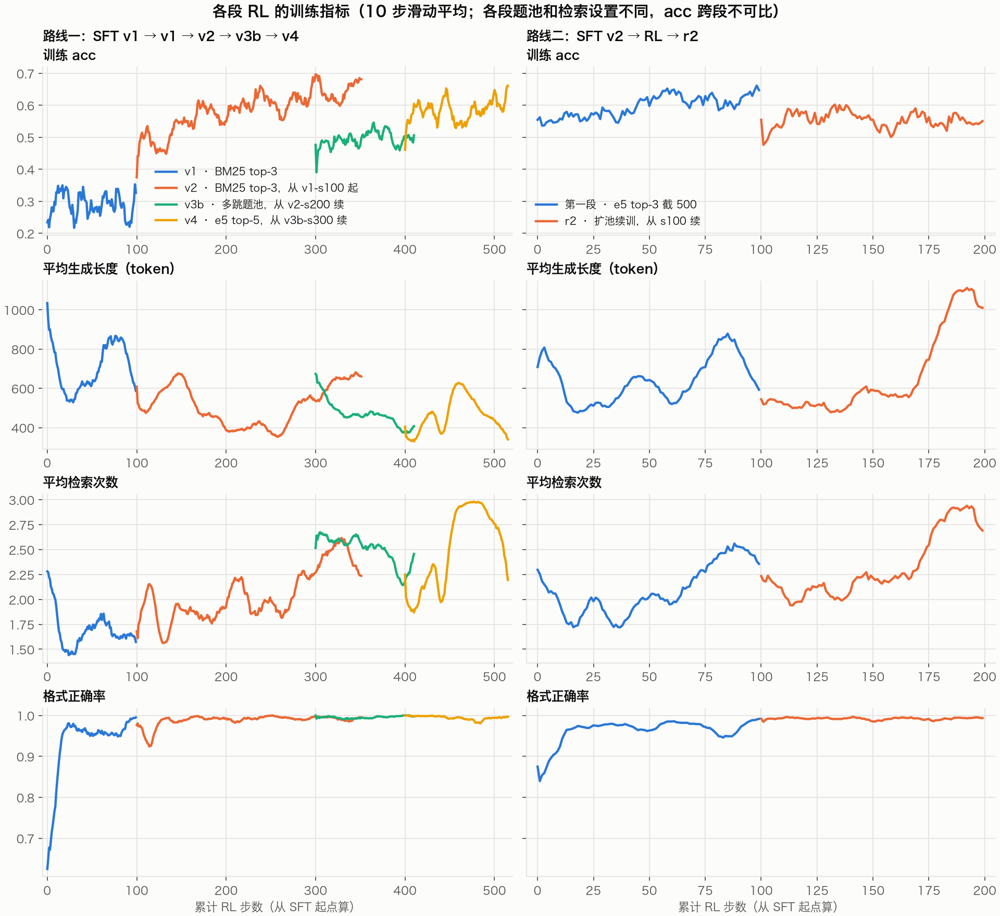

# RWKV-7 2.9B Search-R1：SFT + RL 全线总览

更新：2026-10-29 ｜ 模型：rwkv7-g1k-2.9b-20260930（MiSS adapter）｜ 训练服务端：[rwkv_lightning_cuda](https://github.com/Alic-Li/rwkv_lightning_cuda) 在线 RL（GRPO）

## 结论

- **两条路线都停在约 0.40**（榜单协议七集抽样平均 EM）：
  - 路线一最好是 v4-s100 0.404。
  - 路线二最好是 r2-s150 0.399。
  - 二者的差别在 ±1.2 点的误差范围内。
- 对照：同协议下 Search-R1 论文的 7B Base PPO 是 0.431；我们给自己定的目标是 0.45。
- **收益主要来自 SFT 和第一段 RL**：
  - 基础模型 0.051；SFT v1 0.318（学会工具调用格式）；路线一的 RL 再加约 8 点（v1 + v2，到 v2-s200 0.399）。
  - 路线二：SFT v2 起点 0.379，RL 100 步加约 2 点。
  - 之后继续 RL（v3b、v4、r2）在 held-out 上都是零增益。训练池里的 acc 还在涨，但那是背题。
- **上限还在**：r2-s150 每题采 8 次，至少一次答对的比例（pass@8）是 0.579，8 次投票（maj@8）是 0.443。很多题模型其实会做，只是贪心解码时没答对。现在的 RL 没能把这部分收进来。
- **下一步：Dr. GRPO。** 10-28 夜间用更大学习率试了三组都失败了（见下文「夜间调参」），初步判断问题出在 loss 的长度归一化。需求已经提给服务端同事。


## 和 SearchAgent 榜单对比



- 按七集平均，2.9B 高于所有 3B，也高于 7B 的 ZeroSearch 和 Search-R1，只低于 ReSeek-7B（差 1.9 点）。
- 不能直接等同于榜单排名：
  - 榜单用完整测试集，我们每集抽 300 题（Bamboogle 全部 125 题）。
  - 榜单正式排名用八集平均，多一个 FictionalHot。各家在这一集只有 0.01–0.06，所以八集平均比七集平均低 4–5 点；我们没跑这一集。
  - 我们 RL 前做过教师（Qwen3.7-Flash）蒸馏 SFT，agent 格式也和上游不同，提交时需要说明。
- 榜单分数是 2026-10-29 从 [TencentBAC/SearchAgent_Leaderboard](https://huggingface.co/spaces/TencentBAC/SearchAgent_Leaderboard) 的 `eval-results/*.json` 拉的，原文件存在 [provenance/rl-lineage-20261029/leaderboard/](../provenance/rl-lineage-20261029/leaderboard/)。

<details>
<summary>分集分数</summary>

| 方法 | NQ | TQA | PopQA | Hotpot | 2Wiki | MuSiQue | Bamb. | 七集 | FH | 八集 |
|---|---|---|---|---|---|---|---|---|---|---|
| ReSeek-7B | .469 | .640 | .501 | .389 | .382 | .185 | .392 | **.423** | .061 | .377 |
| **我们 v4-s100** | .377 | .607 | .473 | .410 | .370 | .150 | .440 | **.404** | — | — |
| **我们 r2-s150** | .373 | .663 | .440 | .377 | .340 | .170 | .432 | **.399** | — | — |
| ZeroSearch-7B | .436 | .652 | .488 | .346 | .352 | .184 | .278 | **.391** | .031 | .346 |
| Search-R1-7B | .393 | .610 | .397 | .370 | .414 | .146 | .368 | **.385** | .034 | .342 |
| ReSeek-3B | .415 | .553 | .434 | .328 | .298 | .103 | .304 | **.348** | .059 | .312 |
| Search-R1-3B | .341 | .545 | .378 | .324 | .319 | .103 | .264 | **.325** | .037 | .289 |
| ZeroSearch-3B | .414 | .574 | .448 | .274 | .300 | .098 | .111 | **.317** | .030 | .281 |
| RAG-7B | .349 | .585 | .392 | .299 | .235 | .058 | .208 | **.304** | .012 | .267 |

榜单各家都是 Qwen2.5-Instruct。FH = FictionalHot。
</details>

## 评测口径（榜单协议）

| 项 | 设置 |
|---|---|
| 题库 | `data/search_r1/test_upstream7_s300.parquet`：NQ / TriviaQA / PopQA / HotpotQA / 2Wiki / MuSiQue 各 300 题，Bamboogle 125 题，共 1925 题 |
| 检索 | e5 Flat，top-3，每次检索结果截到 500 token |
| 轮次 | 最多 4 次检索，再加 1 轮只答（`--max_turns 4 --final_answer_turn`） |
| 解码 | 贪心 |
| 指标 | 每集 EM 的简单平均（同 Search-R1 论文）。单集误差约 ±2.8 点，七集平均约 ±1.2 点 |

对应 TencentBAC 的 [SearchAgent Leaderboard](https://huggingface.co/spaces/TencentBAC/SearchAgent_Leaderboard) 协议。

## 全线检查点

| 检查点 | NQ | TriviaQA | PopQA | HotpotQA | 2Wiki | MuSiQue | Bamboogle | **七集平均** | format_ok | 检索次数 |
|---|---|---|---|---|---|---|---|---|---|---|
| 基础模型 | 0.027 | 0.147 | 0.033 | 0.067 | 0.017 | 0.027 | 0.040 | **0.051** | 0.196 | 2.73 |
| **路线一** | | | | | | | | | | |
| SFT v1 | 0.327 | 0.513 | 0.347 | 0.320 | 0.247 | 0.103 | 0.368 | **0.318** | 0.759 | 2.28 |
| v1-s100 | 0.333 | 0.543 | 0.377 | 0.303 | 0.340 | 0.113 | 0.376 | **0.341** | 0.980 | 1.86 |
| v2-s200 | 0.383 | 0.620 | 0.437 | 0.387 | 0.393 | 0.157 | 0.416 | **0.399** | 0.997 | 2.86 |
| v3b-s300 | 0.397 | 0.627 | 0.443 | 0.397 | 0.390 | 0.163 | 0.376 | **0.399** | 0.998 | 2.29 |
| v4-s50 | 0.387 | 0.577 | 0.447 | 0.397 | 0.367 | 0.127 | 0.392 | **0.385** | 0.952 | 3.55 |
| v4-s100 | 0.377 | 0.607 | 0.473 | 0.410 | 0.370 | 0.150 | 0.440 | **0.404** | 0.998 | 3.36 |
| v4-s110 | 0.397 | 0.603 | 0.463 | 0.407 | 0.353 | 0.133 | 0.384 | **0.392** | 1.000 | 2.86 |
| **路线二** | | | | | | | | | | |
| SFT v2 | 0.340 | 0.577 | 0.393 | 0.380 | 0.377 | 0.153 | 0.432 | **0.379** | 0.811 | 2.23 |
| RL s50 | 0.383 | 0.570 | 0.417 | 0.353 | 0.330 | 0.183 | 0.424 | **0.380** | 0.931 | 2.12 |
| RL s100 | 0.377 | 0.583 | 0.430 | 0.387 | 0.390 | 0.183 | 0.432 | **0.397** | 0.990 | 2.48 |
| r2-s150 | 0.373 | 0.663 | 0.440 | 0.377 | 0.340 | 0.170 | 0.432 | **0.399** | 0.984 | 2.47 |
| r2-s170 | 0.390 | 0.617 | 0.460 | 0.380 | 0.340 | 0.167 | 0.416 | **0.396** | 0.950 | 2.85 |
| r2-s200 | 0.370 | 0.610 | 0.423 | 0.413 | 0.347 | 0.127 | 0.408 | **0.385** | 0.966 | 2.66 |

数字来自 `outputs/upstream-eval/<检查点>/report.json`。

## 各阶段



横轴是从各自的 SFT 起点累计的 RL 步数。每段的题池和检索设置不同，所以训练 acc 跨段不能直接比，只看段内走势。

### 路线一：SFT v1 → v1 → v2 → v3b → v4

所有 RL 段都是：lr 2e-6，组大小 8，T=1.0，奖励为答对 1 / 格式对但答错 0（v2 起加 0.3×F1）/ 没有合法答案 -0.2。

| 阶段 | 起点 | 题池 | 检索（训练时） | 每步题数 | 步数 | 七集平均 |
|---|---|---|---|---|---|---|
| SFT v1 | 基础模型 | 教师（Qwen3.7-Flash）蒸馏 2000 题，留 843 条轨迹 | — | — | 206 | 0.318 |
| v1 | SFT v1 | 训练集原样，不筛 | BM25 top-3 | 8 | 100 | 0.341 |
| v2 | v1-s100 的 adapter（服务端步数重新计） | 用 v1-s100 筛出的有对有错题，约 1600 | BM25 top-3 | 16 | 252 | 0.399（s200） |
| v3b | v2-s200 完整检查点 | 偏多跳的题池，约 1450 | BM25 top-3 | 16 | 111 | 0.399（s300） |
| v4 | v3b-s300 完整检查点 | 用 e5 top-5 重筛，1664 题 | e5 top-5 | 16 | 116 | 0.404（s100） |

- **v1**：学会了收尾，格式正确率从 0.63 到 1.0；但题池没筛，每步只有 2–4 组有梯度，acc 一直在 0.2–0.35 之间平着。
- **v2**：筛题后每步有效组多了，题池 acc 从 0.49 涨到 0.65。前 150 步主要是背题；150–200 步检索次数上升，held-out 才跟着涨。s200 是峰，续训到 250 没有长进。
- **v3b**：想用多跳题池把「多查」的行为提前学到。held-out 和 v2-s200 打平。
- **v4**：换 e5 检索。训练环境（top-5、3 次检索后提示收尾）和榜单协议不一致，s50 查过头，s100 回来，最终打平。

### 路线二：SFT v2 → RL → r2

路线一的 SFT 数据和榜单协议不一致，所以从基础模型重做 SFT，训练环境直接对齐榜单协议。v1 数据的问题：

- 用的是本地 BM25 检索，最多 3 次检索，检索结果不截断；
- 只有 843 条；
- 教师的思考太长，还会预演检索结果；
- 答案多写一截的轨迹都被丢掉了。

细节见 [sft-v2-plan.md](sft-v2-plan.md) 第二节。

| 阶段 | 起点 | 题池 | 检索（训练时） | 每步题数 | 步数 | 七集平均 |
|---|---|---|---|---|---|---|
| SFT v2 | 基础模型 | e5 检索下教师蒸馏 2000 题，打包 train 1030 / val 60 | — | — | 2 epoch | 0.379 |
| RL | SFT v2 | 用 SFT v2 筛出的有对有错题，734 题 | e5 top-3，截 500 | 16 | 100 | 0.397（s100） |
| r2 | RL s100 完整检查点 | 用 s100 在新题上重筛，1189 题 | e5 top-3，截 500 | 16 | 100 | 0.399（s150） |

- **SFT v2** 起点比 SFT v1 高 6 点，但格式正确率只有 0.81。
- **第一段 RL**：前 10 步把格式补到 0.98，s100 到 0.397，和路线一的最好成绩持平。
- **r2**：s150 0.399、s200 0.385。第 74 步（s174）起进入第二遍题池，生成长度从约 550 涨到 1100 token、检索从 2.2 涨到 2.9 次，分数开始往下掉。

## 上限与错题归因（r2-s150）

| 指标 | 数值 | 说明 |
|---|---|---|
| 贪心 | 0.403 | 每集 150 题、共 997 题的子集 |
| T=1 单次 | 0.393 | 同上 |
| maj@8 | 0.443 | 8 次投票 |
| pass@8 | 0.579 | 8 次里至少对一次；36% 的题有对有错 |

错题归因（`scripts/error_breakdown.py`，全部 1925 题）：

| 类别 | 占全部题 |
|---|---|
| 对 | 0.396 |
| 检索没查到（所有检索结果里都没有答案） | 0.322 |
| 查到没读对 | 0.153 |
| 措辞差一点（答对了实体，EM 没算上） | 0.113 |
| 未作答 | 0.016 |

## 10-28 夜间调参（简述）

想用更大的学习率把 pass@8 和贪心之间的差距收进来，从路线二 s100 起试了三组：

- lr 1e-5；
- lr 5e-6 加预热；
- 再加上每条轨迹等权、负优势减半。

前两组在几步内就崩了，症状是越写越长、不给答案。第三组没崩，但反过来越写越短，终点 0.378。

初步判断：

- 服务端 loss 按全批 token 数归一化，答错的轨迹更长，负梯度占多数，模型就越写越长。
- 改成按轨迹归一化，又会偏向变短。

所以下一步换成 Dr. GRPO 的固定常数归一化。细节见 [rl-status-2026-10-29.md](rl-status-2026-10-29.md)。

## 下一步

1. **Dr. GRPO**：loss 用固定常数归一化，不随轨迹长度变；在这个基础上再试大学习率。需求已提给服务端。
2. 每步题数从 16 加到 32–64，减少梯度噪声。
3. 拒绝采样自蒸馏：训练题每题采 8 次，只留答对的样本做 SFT。目标是把 maj@8 的 0.443 变成贪心水平。
4. 答案统一成短实体，处理「措辞差一点」的 11%。

## 复现与留存

- 全线的训练指标、脚本快照和校验和：[provenance/rl-lineage-20261029/](../provenance/rl-lineage-20261029/README.md)。
- SFT v2 的数据来源、蒸馏和训练命令：[provenance/sft-v2-20261027/](../provenance/sft-v2-20261027/README.md)。
- 各检查点的评测摘要：`outputs/upstream-eval/*/report.json`。

重画本文的图只需要本机：

```bash
.venv/bin/python scripts/plot_rl.py
```

各阶段的详细记录：

- [rl-status-2026-10-26.md](rl-status-2026-10-26.md)：v1、v2、v3b
- [rl-status-2026-10-27.md](rl-status-2026-10-27.md)：v3b 结案、检索矩阵、e5 基建
- [rl-status-2026-10-27-pm.md](rl-status-2026-10-27-pm.md)：榜单协议对齐、v4 结案
- [sft-v2-plan.md](sft-v2-plan.md)：SFT v2 规划
- [rl-status-2026-10-29.md](rl-status-2026-10-29.md)：路线二 r2、上限分析、夜间调参
