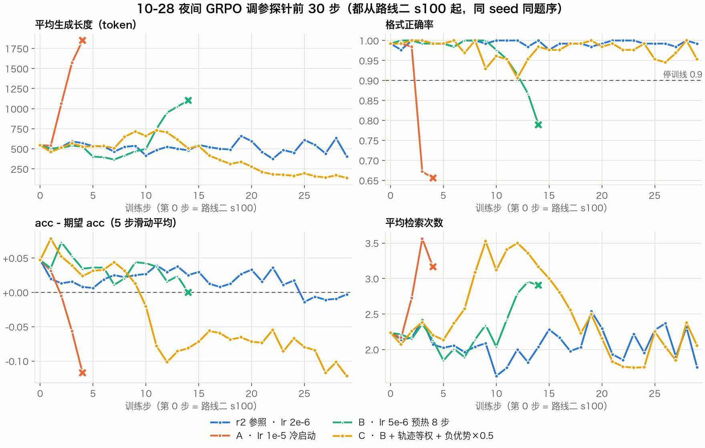

# Search-R1 RL 状态报告（10-28 夜间调参）

日期：2026-10-29 ｜ 覆盖：SFT v2 第二段 RL（r2）评测 → pass@8 上限 → 错题归因 → 三组调参探针

## TL;DR

- **目标 0.45 今晚没达到**。榜单协议七集抽样最好仍是 **r2-s150 0.399**（SFT v2 → RL s100 0.397）。
- **上限还有空间**：s150 在 T=1 下每题采 8 次，**pass@8 = 0.579，maj@8 = 0.443**，贪心 0.403。36% 的题 8 次里有对有错，说明「把已经会的答对」这条路（RL 磨锐）理论上还能涨不少。
- **但现在的 GRPO 推不动**：
  - 学习率 2e-6：稳定，但 100 步训练信号（diff）平在 +0.02，学不动。
  - 1e-5 冷启动：第 3 步就崩。
  - 5e-6 + 8 步预热：第 11–14 步崩。
  - 两次崩溃的症状一样：生成长度翻倍，不给答案，格式正确率跌破 0.9。
- **崩溃原因（判断）**：
  - 服务端 loss 按全批 token 数归一化，而答错的轨迹本来就更长（775 对 627 token，检索 2.61 次对 2.21 次）。
  - 所以负优势的 token 占多数，整体梯度在「压低已采样 token 的概率」，熵被推高，模型越写越长、不收尾。
  - 第三组（`--seq_norm --neg_scale 0.5`）针对这个做了修正：变长崩没再出现，但矫枉过正，变成越写越短，终点评测 0.378（比起点低 1.9 点）。
- **结论**：现在的瓶颈不在学习率，在 loss 的长度归一化方式。
  - 按 token 归一化会偏向变长，按轨迹归一化会偏向变短。
  - 下一步应该试 Dr. GRPO 的做法：用固定常数（比如 max_turn_tokens × 轮数）归一化，不随轨迹长度变。
  - 另一条路是先做拒绝采样自蒸馏，这个更稳（见第五节）。
- **分丢在哪（s150 错题归因）**：检索没查到 32%、查到没读对 15%、措辞差一点 11%。检索这一块受榜单协议限制（e5 top-3），只能靠模型自己改写检索词。

## 一、SFT v2 第二段 RL（r2）评测

榜单协议：e5 top-3、检索结果截 500 token、4 次检索 + 1 轮只答、贪心，七集抽样 1925 题。

| 检查点 | NQ | TriviaQA | PopQA | HotpotQA | 2Wiki | MuSiQue | Bamboogle | **七集平均** | format_ok | 检索次数 |
|---|---|---|---|---|---|---|---|---|---|---|
| SFT v2（lr3e-5） | 0.340 | 0.577 | 0.393 | 0.380 | 0.377 | 0.153 | 0.432 | **0.379** | 0.811 | 2.23 |
| RL s100（r2 起点） | 0.377 | 0.583 | 0.430 | 0.387 | 0.390 | 0.183 | 0.432 | **0.397** | 0.990 | 2.48 |
| r2-s150 | 0.373 | 0.663 | 0.440 | 0.377 | 0.340 | 0.170 | 0.432 | **0.399** | 0.984 | 2.47 |
| r2-s170 | 0.390 | 0.617 | 0.460 | 0.380 | 0.340 | 0.167 | 0.416 | **0.396** | 0.950 | 2.85 |
| r2-s200 | 0.370 | 0.610 | 0.423 | 0.413 | 0.347 | 0.127 | 0.408 | **0.385** | 0.966 | 2.66 |

七集平均的误差约 ±1.2 点，s100–s170 之间的差别都在噪声内。题池 1189 题、每步 16 题，r2 第 74 步（s174）起进入第二个 epoch。之后生成长度从约 550 涨到 1100 token、检索从 2.2 次涨到 3 次（见图 2 右列），s200 掉到 0.385。


## 二、上限：每题采 8 次（r2-s150，T=1，每集 150 题，共 997 题）

| 集 | acc@1 | pass@8 |
|---|---|---|
| NQ | 0.322 | 0.460 |
| TriviaQA | 0.617 | 0.753 |
| PopQA | 0.471 | 0.633 |
| HotpotQA | 0.403 | 0.560 |
| 2Wiki | 0.373 | 0.660 |
| MuSiQue | 0.151 | 0.333 |
| Bamboogle | 0.416 | 0.624 |
| **全部** | **0.393** | **0.579** |

- 同一批题：贪心 0.403，maj@8 0.443。
- pass@k 当作 RL 磨锐能达到的上限，是 RL 领域常用的做法（例如 Yue et al. 2025 *Does RL Really Incentivize Reasoning Capacity…* 的结论就是 RL 主要把 pass@k 压缩进 pass@1）。
- 0.45 大约相当于把 pass@8 和贪心之间的差距补回三分之一，maj@8 已经接近这个数。

## 三、错题归因（r2-s150 贪心，`scripts/error_breakdown.py`）

| 类别 | 占全部题 | 说明 |
|---|---|---|
| 对 | 0.396 | |
| 检索没查到 | 0.322 | 所有检索结果里都没有标准答案 |
| 查到没读对 | 0.153 | 检索结果里有答案，但答错了 |
| 措辞差一点 | 0.113 | 预测和答案互相包含或 F1 ≥ 0.5，EM 没算上 |
| 未作答 | 0.016 | 没给出最终答案 |

## 四、调参探针（都从 RL s100 起，题池 `sft2-s100-e5t3`，seed 1234，与 r2 同题序）

新版服务端（d93775e，学习率逐请求传入，修了内存泄漏）。脚本：`scripts/probe.sh`（训练 30 步 → 停服务端 → 榜单协议评测终点）、`scripts/probe_diff.py`（每步实际 acc 减去按题池标签算的期望 acc，即 diff）。客户端新增：

- `--warmup_steps`：线性预热学习率。
- `--abort_fmt`：格式正确率连续 2 步低于阈值就停训。
- `--seq_norm`：优势乘「批内平均生成长度 / 本条长度」，让每条轨迹的总权重相等。
- `--neg_scale`：负优势乘一个系数。

| 探针 | 设置 | 结果 |
|---|---|---|
| r2（参照） | lr 2e-6 | 100 步稳定，diff 一直 ≈ +0.02，没在学 |
| A | lr 1e-5，冷启动 | 第 3 步崩：fmt 0.67，生成 1571 token，跑满轮次 37 条（目录已挪到 `outputs/rl/probe-lr1e-5-collapsed`） |
| B | lr 5e-6，预热 8 步 | 第 0–10 步 diff +0.039，fmt 0.995；预热到顶后第 11–14 步生成 748→1104 token，fmt 0.95→0.79，停训 |
| C | lr 5e-6，预热 8 步，`--seq_norm --neg_scale 0.5` | 没再变长崩，fmt 全程 ≥ 0.91；但第 16 步后生成长度一路缩短（534→137 token），diff 掉到 -0.095。**终点评测 0.378**，比起点低 1.9 点 |

A 和 B 的共同点：学习率一到 5e-6 以上，模型就开始越写越长、不收尾。r2 的轨迹分析也说明奖励信号本身是指向「少查、短答」的。在有对有错的组里：

- 答对的平均 627 token、检索 2.21 次；答错的 775 token、2.61 次。
- 按检索次数看准确率：1 次 0.65、2 次 0.62、3 次 0.57、4 次 0.37。



所以 A、B 的崩溃不是奖励设计把模型往长里带，而是 loss 的 token 级归一化让长的错误轨迹在梯度里占了多数。

C 改成每条轨迹等权之后，长度偏差反了过来：短轨迹的每个 token 权重被放大，模型学会写短就能拿到更大的正梯度。这正是 Dr. GRPO（Liu et al. 2025 *Understanding R1-Zero-Like Training*）指出的长度偏差。

C 终点（s30）七集：NQ 0.387、TriviaQA 0.563、PopQA 0.447、HotpotQA 0.360、2Wiki 0.377、MuSiQue 0.133、Bamboogle 0.376，平均 0.378，format_ok 0.993，检索 2.75 次。

## 五、要到 0.45 还需要什么（建议按顺序试）

1. **先让大学习率稳下来**：
   - 第三组说明每条轨迹等权（`--seq_norm`）会偏向变短。
   - 下一步改成 Dr. GRPO：每条轨迹的优势乘「固定常数 / 全批 token 数」，等价于用固定常数归一化。客户端可以做，只需把 `scale_adv` 里的 `mean_len / len` 换成按全批 token 数换算的固定系数。
   - 可以和 `--neg_scale` 搭配，单独试一次。
   - 对参考策略加 KL（客户端已有 `--kl_coef`）。
   - 对超长轨迹加惩罚（DAPO 的 soft overlong）。
2. **加大每步的题量**。现在每步 16 题 × 8 次，有效（有对有错）的组只有 9–12 个，梯度噪声大。改成每步 32–64 题，学习率可以相应调高。代价是每步时间按题量线性增长。
3. **拒绝采样自蒸馏（RAFT / expert iteration）**，比 GRPO 稳得多，最有希望补上 pass@8 和贪心之间的差：
   - 在训练题池上每题采 8 次，只留答对且检索次数最少的那条，做一轮 SFT，再回到 RL。
   - maj@8 已经 0.443，这条路的目标就是把 maj@8 的水平变成贪心的水平。
4. **措辞差一点的 11%**：
   - 在 SFT 数据里把答案统一成短实体。
   - 或者 RL 改成只看 EM（`--f1_weight 0`），F1 部分分正好在奖励「差一点」。
   - 这一块便宜，估计能拿回 1–3 个点。
5. **检索没查到的 32%** 是最大头，但榜单协议固定了检索器（e5 top-3）。只能靠检索词改写：
   - 多跳题拆问题、换实体名再查。
   - 可以用教师模型蒸馏更好的检索词，做 SFT v3。

## 附：留存与复现

数据、脚本快照、校验和与复现命令都在 [provenance/rl-lineage-20261029/](../provenance/rl-lineage-20261029/README.md)。重画三张图只需要本机：

```bash
.venv/bin/python scripts/plot_rl.py
```

## 附：命令

```bash
# 探针（服务器包根目录，screen 里）
NAME=<名字> LR=5e-6 CLIENT_EXTRA="--warmup_steps 8 --abort_fmt 0.9 --seq_norm --neg_scale 0.5" bash scripts/probe.sh 2>&1 | tee -a outputs/probe-<名字>.log
# 训练信号对照
.venv/bin/python scripts/probe_diff.py outputs/rl/probe-<名字> outputs/rl/sft2-grpo-r2 --max_step 30
# 任意 adapter 按榜单协议评测
bash scripts/eval_adapter.sh <adapter_id> <adapter.pth>
# 错题归因
.venv/bin/python scripts/error_breakdown.py outputs/upstream-eval/<run>/samples.jsonl
```
